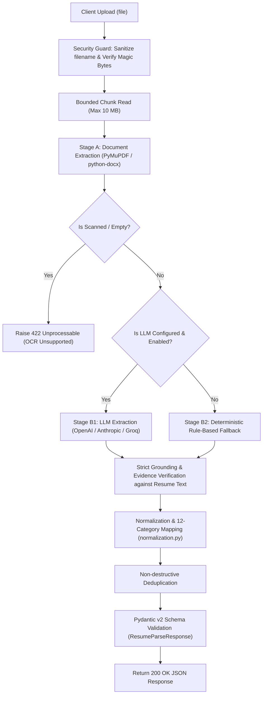
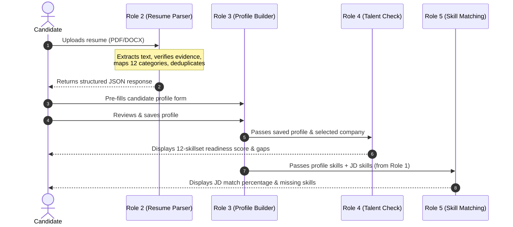

# RADIX Talent Match — Role 2: Resume Parsing
## Comprehensive Integration & Handoff Guide

> **Authoritative Handoff Document**  
> This guide is intended for developers, integration engineers, and AI coding agents integrating Role 2 (Resume Parsing) into the complete RADIX Talent Match solution.

---

## A. Component Identity and Scope

- **Project Name**: RADIX Talent Match
- **Role**: Role 2 — Resume Parsing
- **Component Purpose**: Converts unstructured candidate resumes in PDF and DOCX format into structured, validated JSON matching the authoritative RADIX Shared Data Contract.

### Explicit Responsibilities:
- In-memory text extraction from PDF (PyMuPDF) and DOCX (`python-docx`).
- Table cell and paragraph visual sequence preservation for Word documents.
- Detection and accurate reporting of scanned / image-only PDFs (no OCR).
- Extraction of candidate contact information (`name`, `email`, `phone`, `location`).
- Extraction of technical and soft skills with verified, traceable verbatim evidence.
- Categorization of all skills into the 12 RADIX categories (`COD`, `DSA`, `OOD`, `APTI`, `COMM`, `AI`, `CLOUD`, `SQL`, `SWE`, `SYSD`, `NETW`, `OS`) or `OTHER`.
- Canonical skill name normalization and non-destructive deduplication.
- Structured extraction of `education`, `projects`, `experience`, `internships`, `hackathons`, `certifications`, and `preferred_roles`.
- Deterministic fallback parsing when no LLM API key is configured.
- Security-hardened HTTP upload handling (anti-traversal sanitization, bounded chunk streaming, magic bytes verification).

### Explicit Non-Responsibilities (Handled by Other Roles):
- **Role 1 (JD Analytics)**: Extraction of job requirements from Job Descriptions.
- **Role 3 (Profile Builder)**: Candidate profile management, web forms, database persistence, and profile editing.
- **Role 4 (Talent Check)**: Candidate competency scoring (1–10 levels) and 12-skillset gap analysis against company bars.
- **Role 5 (Skill Matching)**: Candidate-to-JD match scoring and missing skill gap lists.
- **Data Persistence**: This service does not directly read from or write to Supabase, PostgreSQL, or disk files.
- **Frontend**: This service is a pure headless backend API.

---

## B. Actual Project Structure

The project lives in `resume_parser/` with this exact structure:

```
resume_parser/
├── app/
│   ├── __init__.py                # Package metadata and version definition
│   ├── main.py                    # FastAPI application, lifespan, exception handlers
│   ├── config.py                  # Environment settings, secret masking, upload limits
│   ├── schemas.py                 # Pydantic v2 domain schemas (RADIX contract, enums, models)
│   ├── exceptions.py              # Domain exceptions mapping to exact HTTP status codes
│   ├── api/
│   │   ├── __init__.py            # API routing module init
│   │   └── routes.py              # Route handlers: /health, /parse, /validate
│   ├── services/
│   │   ├── __init__.py            # Services module init
│   │   ├── document_extractor.py  # PyMuPDF and python-docx text/table extractors
│   │   ├── normalization.py       # Canonical catalog, 12-category mapping, deduplication
│   │   ├── llm_extractor.py       # Native provider LLM client (OpenAI, Groq, Anthropic)
│   │   └── resume_parser.py       # Two-stage pipeline orchestrator and fallback engine
│   └── utils/
│       ├── __init__.py            # Utilities module init
│       ├── security.py            # Anti-traversal sanitization, magic bytes, bounded read
│       └── logging_config.py      # Redacting logger preventing PII and secret leaks
├── tests/
│   ├── test_document_extractor.py # Document parsing, tables, corrupt/scanned PDF tests
│   ├── test_schemas.py            # Pydantic schema validation, enums, contract tests
│   ├── test_resume_parser.py      # Grounding, normalization, Anthropic/OpenAI mocked tests
│   ├── test_api.py                # End-to-end HTTP API tests, status codes, 413 limit
│   └── test_security.py           # Filename sanitization, log redaction, rate limiter
├── sample_data/                   # Local fixtures: sample candidate resumes (PDF & DOCX)
├── .env.example                   # Environment configuration template
├── .gitignore                     # Git exclusion rules
├── requirements.txt               # Locked Python dependencies
├── README.md                      # General documentation
└── INTEGRATION.md                 # This document
```

---

## C. Input: Where Data Enters

All communication with Role 2 occurs through the **HTTP REST API**. Downstream components must **never import internal Python modules directly**.

### 1. Document Parsing Endpoint: `POST /api/v1/resume-parser/parse`
- **Method**: `POST`
- **Content-Type**: `multipart/form-data`
- **Form Field**: `file` (must contain the binary resume file)
- **Accepted Formats**: `.pdf`, `.docx`
- **Maximum File Size**: 10 MB (configured via `MAX_UPLOAD_SIZE_MB`)
- **Memory Safety**: Uploads are read in bounded 64 KB chunks. If an upload exceeds the limit, transfer terminates immediately with `413 Payload Too Large` without buffering the entire file into RAM.
- **Storage**: Uploaded bytes are processed completely in memory streams (`io.BytesIO`). No temporary files are written to the host filesystem.

### 2. Candidate JSON Validation Endpoint: `POST /api/v1/resume-parser/validate`
- **Method**: `POST`
- **Content-Type**: `application/json`
- **Body**: Candidate profile or resume parse result JSON
- **Purpose**: Validates arbitrary candidate payloads against the RADIX contract without parsing a document. Returns actionable field errors.

---

## D. Processing Pipeline

When a resume document is posted to `POST /api/v1/resume-parser/parse`, it flows through the following deterministic pipeline:



---

## E. Output: Where Data Can Be Accessed

The output is returned **directly in the HTTP response body** as JSON. It is not written to disk or a database.

### Primary Response Structure (`POST /api/v1/resume-parser/parse`)

```json
{
  "schema_version": "1.0",
  "source_type": "resume",
  "source_file": "Ananya Rao.pdf",
  "candidate": {
    "name": "Ananya Rao",
    "email": null,
    "phone": null,
    "location": null
  },
  "company": null,
  "role": null,
  "skills": [
    {
      "skill_name": "Python",
      "category_code": "COD",
      "evidence": "C++, Python, Java, Data Structures & Algorithms",
      "confidence": "high"
    },
    {
      "skill_name": "Data Structures & Algorithms",
      "category_code": "DSA",
      "evidence": "C++, Python, Java, Data Structures & Algorithms",
      "confidence": "high"
    },
    {
      "skill_name": "Redis",
      "category_code": "SYSD",
      "evidence": "Built a distributed URL-shortening service with a Redis-backed cache",
      "confidence": "medium"
    }
  ],
  "education": [
    {
      "institution": null,
      "degree": "B.Tech",
      "field_of_study": "Computer Science and Engineering",
      "start_date": null,
      "end_date": "2026",
      "grade": "8.6 / 10",
      "evidence": "B.Tech, Computer Science and Engineering, Class of 2026 — CGPA 8.6 / 10"
    }
  ],
  "projects": [
    {
      "name": "Built a distributed URL-shortening service",
      "description": "Built a distributed URL-shortening service with a Redis-backed cache and a horizontally-scalable API layer as a capstone systems project",
      "technologies": ["Redis"],
      "responsibilities": [],
      "evidence": "Built a distributed URL-shortening service with a Redis-backed cache..."
    }
  ],
  "experience": [
    {
      "organization": null,
      "job_title": "Intern",
      "employment_type": "internship",
      "start_date": null,
      "end_date": null,
      "description": "Summer intern, backend team at a mid-size product startup — shipped a rate-limiter used in production",
      "technologies": [],
      "evidence": "Summer intern, backend team at a mid-size product startup..."
    }
  ],
  "hackathons": [
    {
      "name": "Finalist, national-level 24-hour hackathon",
      "award_or_role": "Finalist",
      "description": "Finalist, national-level 24-hour hackathon — built a real-time chat backend",
      "evidence": "Finalist, national-level 24-hour hackathon — built a real-time chat backend"
    }
  ],
  "internships": [
    {
      "organization": null,
      "role": "Intern",
      "start_date": null,
      "end_date": null,
      "description": "Summer intern, backend team at a mid-size product startup — shipped a rate-limiter used in production",
      "technologies": [],
      "evidence": "Summer intern, backend team at a mid-size product startup..."
    }
  ],
  "certifications": [],
  "preferred_roles": ["Software Engineer", "Backend Engineer"],
  "cv_file": "Ananya Rao.pdf",
  "metadata": {
    "status": "success",
    "extraction_method": "deterministic_fallback",
    "warnings": [
      "LLM extraction disabled or unconfigured; extracted using deterministic fallback engine."
    ],
    "skill_count": 14
  }
}
```

### Representation Rules:
- **Missing Scalars**: Explicitly `null` (never fabricated).
- **Missing Collections**: Empty lists `[]` (never omitted or null).
- **Source Type**: Always `"resume"`.
- **File Names**: Clean base filename (`cv_file` equals sanitized `source_file`), never an absolute path.
- **Evidence**: Verbatim string excerpt from the resume. Generic fabricated evidence (e.g., `"Evidence found in resume for X"`) is strictly prohibited and eliminated.

---

## F. Exact Setup and Execution Instructions

### 1. Prerequisites
- Python 3.11 or later
- Pip package manager

### 2. Installation Commands

#### Windows PowerShell:
```powershell
Set-Location -Path "C:\Users\udaya_\.gemini\antigravity\scratch\resume_parser"
python -m venv .venv
.\.venv\Scripts\Activate.ps1
python -m pip install -r requirements.txt
```

#### Windows Command Prompt:
```cmd
cd /d C:\Users\udaya_\.gemini\antigravity\scratch\resume_parser
python -m venv .venv
.venv\Scripts\activate
python -m pip install -r requirements.txt
```

### 3. Environment Configuration
Copy `.env.example` to `.env`:
```powershell
Copy-Item .env.example .env
```
Default configuration works immediately with **zero paid API keys**:
```env
APP_ENV=development
MAX_UPLOAD_SIZE_MB=10
LLM_ENABLED=false
LLM_PROVIDER=openai
LLM_MODEL=gpt-4o-mini
LLM_API_KEY=
LLM_TIMEOUT_SECONDS=30
LOG_LEVEL=INFO
RATE_LIMIT_PER_MINUTE=60
```

### 4. Starting the Server
```powershell
uvicorn app.main:app --reload --host 127.0.0.1 --port 8000
```
- Interactive Swagger UI: [http://127.0.0.1:8000/docs](http://127.0.0.1:8000/docs)
- OpenAPI Specification: [http://127.0.0.1:8000/openapi.json](http://127.0.0.1:8000/openapi.json)

### 5. Running the Automated Test Suite
```powershell
python -m pytest tests/ -v
```

### 6. Example API Invocations

#### PowerShell:
```powershell
$filePath = "sample_data\PDF\Ananya Rao.pdf"
$form = @{
    file = Get-Item -Path $filePath
}
$response = Invoke-RestMethod -Uri "http://127.0.0.1:8000/api/v1/resume-parser/parse" -Method Post -Form $form
$response | ConvertTo-Json -Depth 5
```

#### Python (`requests`):
```python
import requests

with open("sample_data/PDF/Ananya Rao.pdf", "rb") as f:
    files = {"file": ("Ananya Rao.pdf", f, "application/pdf")}
    res = requests.post("http://127.0.0.1:8000/api/v1/resume-parser/parse", files=files)
    res.raise_for_status()
    data = res.json()
    print("Parsed candidate:", data["candidate"]["name"])
    print("Extracted skills:", len(data["skills"]))
```

---

## G. Shared Contract for Integration

### The 12 RADIX Skill Categories:
Every skill object emitted by Role 2 contains exactly one of these categories:

1. `COD` — Coding (Python, C++, Java, Go, Rust, JS, TS, HTML/CSS, Bash)
2. `DSA` — Data Structures & Algorithms (Trees, Graphs, Sorting, DP, LeetCode)
3. `OOD` — Object-Oriented Design (Design Patterns, LLD, SOLID, OOP)
4. `APTI` — Aptitude (Logical Reasoning, Quantitative Analysis)
5. `COMM` — Communication (Technical Writing, Mentoring, Presentation)
6. `AI` — Artificial Intelligence (ML, DL, PyTorch, scikit-learn, Data Science, A/B Testing)
7. `CLOUD` — Cloud (AWS, Azure, GCP, Docker, Kubernetes, CI/CD, Terraform)
8. `SQL` — SQL (PostgreSQL, MySQL, SQLite, Oracle DB, Normalization)
9. `SWE` — Software Engineering (Git, Unit Testing, Agile, IT Support, Ticketing Tools)
10. `SYSD` — System Design (Distributed Systems, Microservices, Caching, Redis, Kafka)
11. `NETW` — Networking (Computer Networks, TCP/IP, HTTP/HTTPS, WebSockets, DNS)
12. `OS` — Operating Systems (Linux, Unix, Process Scheduling, Multithreading, Concurrency)
- `OTHER` — Permitted fallback for business tools (Excel, Power BI, Tableau, UI/UX)

### Internship and Experience Relationship:
To prevent discrepancies across components:
- **`internships`** is a structured list containing dedicated internship records (`organization`, `role`, `start_date`, `end_date`, `description`, `technologies`, `evidence`).
- **`experience`** represents the candidate's complete employment timeline. Any internship is also present in `experience` with `employment_type="internship"`. Non-internship jobs have `employment_type="full-time"`.
- Downstream components requiring overall tenure query `experience`, while components populating internship-specific forms (such as Role 3) consume `internships`.

---

## H. Integration with Role 3: Profile Builder

Role 3 (**Profile Builder**) allows candidates to review and enhance their parsed profile. 

### Data Flow from Role 2 to Role 3:

```
[Candidate uploads Resume]
           │
           ▼
[Role 2: Resume Parser (POST /api/v1/resume-parser/parse)]
           │  (Returns validated JSON)
           ▼
[Role 3: Profile Builder Form]
  ├── Pre-fills: name, email, phone, location
  ├── Pre-populates: Education list
  ├── Pre-populates: Evidenced Skills (12 RADIX categories)
  ├── Pre-populates: Projects & Technologies
  ├── Pre-populates: Internships & Work Experience
  ├── Pre-populates: Hackathons & Certifications
  └── Pre-populates: Preferred Roles & CV filename
```

### Complete Field Handoff Map:

| Candidate Profile Field (Role 3) | Source Field in Role 2 JSON | Data Type | Handling of Missing Data |
|:---|:---|:---|:---|
| `name` | `response["candidate"]["name"]` | `string` or `null` | Render blank text box for user entry |
| `email` | `response["candidate"]["email"]` | `string` or `null` | Render blank text box for user entry |
| `education` | `response["education"]` | `Array<EducationEntry>` | Render education cards or empty list |
| `skills` | `response["skills"]` | `Array<Skill>` | Render skill tags grouped by category code |
| `hackathons` | `response["hackathons"]` | `Array` | Render hackathon entries or empty list |
| `internships` | `response["internships"]` | `Array<InternshipEntry>`| Render internship cards or empty list |
| `certifications` | `response["certifications"]` | `Array<CertificationEntry>`| Render certifications or empty list |
| `preferred_roles` | `response["preferred_roles"]` | `Array<string>` | Render multi-select or tags |
| `cv_file` | `response["cv_file"]` | `string` | Display uploaded filename badge |

### Minimal Role 3 Python Integration Snippet:

```python
import requests

def build_profile_from_cv(cv_path: str) -> dict:
    url = "http://127.0.0.1:8000/api/v1/resume-parser/parse"
    with open(cv_path, "rb") as f:
        resp = requests.post(url, files={"file": f})
        resp.raise_for_status()
        data = resp.json()

    # Form profile object matching Page 10 of the RADIX brief
    profile = {
        "name": data["candidate"]["name"],
        "email": data["candidate"]["email"],
        "education": data["education"],
        "skills": data["skills"],
        "hackathons": data["hackathons"],
        "internships": data["internships"],
        "certifications": data["certifications"],
        "preferred_roles": data["preferred_roles"],
        "cv_file": data["cv_file"]
    }
    return profile
```

---

## I. Integration with the Remaining RADIX Components

1. **Role 1 (JD Analytics)**:
   - Sibling component to Role 2.
   - Extracts required skills from Job Descriptions into the identical shared skill format:
     `{"source_type": "jd", "source_file": "...", "skills": [<Skill>, ...]}`.
2. **Role 4 (Talent Check)**:
   - Consumes the candidate's verified skills list (from Role 3/Role 2).
   - Maps candidate skills onto the 12 RADIX categories and calculates gaps against company-specific hiring bars (1–10 levels).
3. **Role 5 (Skill Matching)**:
   - Takes the candidate's skills (from Role 3/Role 2) and the JD's required skills (from Role 1).
   - Performs fuzzy/exact matching to produce a match score and missing skill gap list.

---

## J. Example End-to-End Flow



---

## K. Error Handling and Operational Limitations

### HTTP Status Codes:
- **`200 OK`**: Successful parse or payload validation.
- **`400 Bad Request`**: Unsupported extension, empty file (0 bytes), content/extension mismatch, or corrupted document.
- **`413 Payload Too Large`**: Uploaded file exceeds configured `MAX_UPLOAD_SIZE_MB`.
- **`422 Unprocessable Entity`**: Scanned/image-only PDF detected (OCR unsupported), or invalid schema submitted to `/validate`.
- **`429 Too Many Requests`**: Client rate limit exceeded or upstream LLM provider rate limit.
- **`502 Bad Gateway`**: Upstream LLM provider failure, authentication error, or malformed provider output.
- **`503 Service Unavailable`**: LLM extraction requested but provider credentials not configured.
- **`500 Internal Server Error`**: Unexpected exception (stack traces and secrets are masked from clients and logged internally).

### Operational Limitations:
1. **Scanned Documents**: The parser intentionally does not embed an OCR binary (e.g. Tesseract). Image-only/scanned PDFs are detected and rejected with `422 Unprocessable Entity` rather than generating empty or hallucinated profiles.
2. **Deterministic Catalog**: In deterministic mode (`LLM_ENABLED=false`), extraction relies on the canonical knowledge catalog. New or obscure technologies not in the catalog will map to `OTHER` unless LLM mode is enabled.
3. **Rate Limiting**: Rate limiting operates per-process using an in-memory sliding window. In multi-container production environments, an external Redis or API Gateway rate limiter should be used.

---

## L. Handoff Checklist

- [x] **Dependencies Installed**: Tested against Python 3.14 / 3.11 with FastAPI, PyMuPDF, python-docx, pydantic.
- [x] **Tests Run**: 47 automated pytest tests passing cleanly (`tests/`).
- [x] **API Starts**: Verified on `http://127.0.0.1:8000`.
- [x] **PDF Parsing Verified**: Synthetic and real candidate resumes (`Ananya Rao.pdf`, etc.) verified.
- [x] **DOCX Parsing Verified**: Paragraph and table structure verified.
- [x] **Response Schema Validated**: Conforms to RADIX Role 2 JSON specification.
- [x] **Evidence Traceability Verified**: Hallucinated/unevidenced skills are omitted; evidence grounded in source text.
- [x] **LLM-Disabled Mode Verified**: Deterministic fallback runs completely offline without API keys.
- [x] **Anthropic Native API Verified**: Native `/v1/messages` contract with `x-api-key` and `system` parameter verified with unit tests.
- [x] **Bounded Upload Reader Verified**: 64 KB chunk reader protects server RAM and returns 413 on limit breach.
- [x] **Role 3 Integration Ready**: Output schema directly pre-fills Role 3 Profile Builder.
- [x] **Known Limitations Documented**: Scanned PDFs and rate-limiter boundaries documented.

